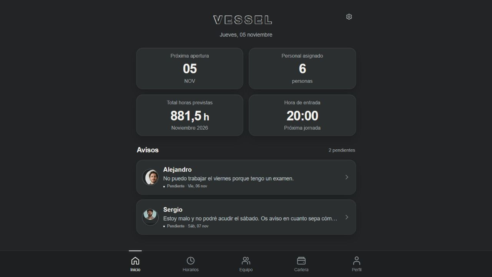

# VESSEL · Horarios y equipo

Mockup interactivo de una aplicación para gestionar los horarios y el equipo de una discoteca. Basado en los diseños de la **Iteración 04** y su identidad **Satin Graphite — Quiet Industrial Luxury**.



## Abrir el prototipo

Descarga este repositorio y abre **index.html** en un navegador moderno. El HTML incluye estilos, lógica e imágenes: no necesita instalación, compilación ni conexión a Internet.

Para servirlo localmente, también puedes ejecutar desde esta carpeta:

```sh
python -m http.server 8000
```

Abre después `http://localhost:8000`.

## Funciones del mockup

- Cinco secciones: Inicio, Horarios, Equipo, Cartera y Perfil; ficha individual secundaria.
- Calendario y edición de jornadas con borrador, guardado, cancelación y retirada reversible.
- Asignación de empleados con advertencias de indisponibilidad.
- Cálculo de turnos nocturnos y sincronización de horas y remuneraciones previstas.
- Directorio, tarifas, disponibilidad y gestión de trabajadores.
- Cartera con búsqueda y selección de periodo; el filtro de búsqueda conserva el total general.
- Envío y revisión de avisos sin modificar automáticamente los horarios.
- Diseño adaptativo a pantalla completa, sin marco artificial de teléfono; paginación móvil para Equipo y Cartera.
- Persistencia en el almacenamiento local del navegador.

El engranaje de Inicio permite cambiar entre los roles de demostración y restablecer los datos. La fecha de referencia de la demo es el **5 de noviembre de 2026**.

## Alcance

Este repositorio contiene un **prototipo frontend con datos sintéticos**. Los roles simulan la experiencia de uso; no existe autenticación ni autorización de servidor. Los datos se conservan en cada navegador y no se sincronizan entre dispositivos. Las cantidades son remuneraciones previstas, no nóminas ni costes empresariales completos.

Para una aplicación de producción se requiere backend, autenticación, permisos aplicados en servidor y almacenamiento compartido.

## Verificación realizada

Se comprobaron visualmente las seis pantallas móviles y las adaptaciones principales de escritorio. En 390 × 844, las cinco vistas principales iniciales caben sin desplazamiento horizontal ni vertical. Se verificaron edición y recálculo económico, avisos, restricciones de la vista de trabajador y advertencias de disponibilidad. El motor de cálculo superó 154 aserciones.
