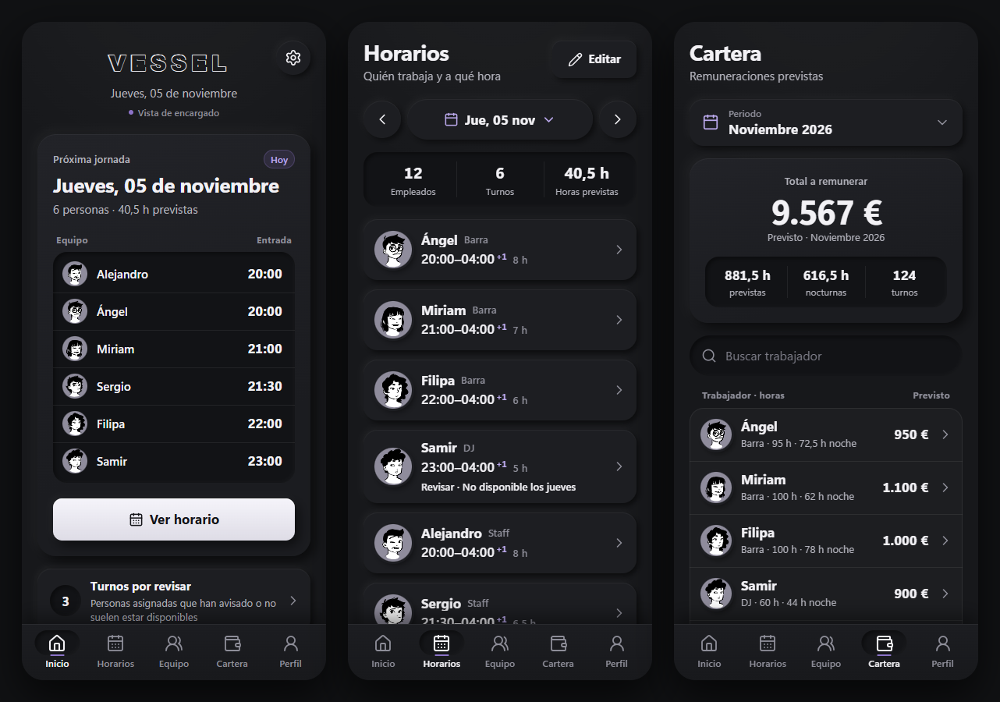

# VESSEL · Horarios y equipo

Mockup interactivo de una aplicación para gestionar los horarios y el equipo de una discoteca. Identidad **Tactile Dark Industrial**: neomorfismo oscuro sobre grafito, con acentos morados discretos. Esta versión es el **makeover** de la 2.0. Mismas funciones, con un sistema visual nuevo, avatares ilustrados e iconos unificados.



## Abrir el prototipo

Descarga este repositorio y abre **index.html** en un navegador moderno. La lógica está en el HTML, los estilos en `css/` y los avatares en `assets/avatars/`. No necesita instalación, compilación ni conexión a Internet.

Para servirlo localmente, también puedes ejecutar desde esta carpeta:

```sh
python -m http.server 8000
```

Abre después `http://localhost:8000`.

## Funciones del mockup

- Cinco secciones: Inicio, Horarios, Equipo, Cartera y Perfil; ficha individual secundaria.
- Calendario, navegación día a día y edición de jornadas con borrador, contador de cambios, guardado, cancelación y retirada reversible.
- Copia de la jornada de la semana anterior, sin saltarse las advertencias de disponibilidad.
- Historial de cambios de cada jornada.
- Asignación de empleados con advertencias de indisponibilidad; turnos en conflicto señalados en Inicio, Horarios y la ficha.
- Cálculo de turnos nocturnos, tarifas conservadas por turno y sincronización de horas y remuneraciones previstas.
- Directorio, tarifas, disponibilidad con varias excepciones y gestión de trabajadores.
- Cartera con búsqueda, selección de periodo, indicadores de horas y exportación CSV; el filtro de búsqueda conserva el total general.
- Envío y revisión de avisos, con respuesta del encargado, sin modificar automáticamente los horarios.
- Perfil con los próximos turnos del trabajador.
- Inicio cabe en una pantalla sin desplazamiento (de 320 × 568 a escritorio). Diseño adaptativo de 320 px a escritorio, con desplazamiento vertical natural en el resto de secciones (Equipo y Cartera solo se paginan a partir de 20 personas) y animaciones que respetan `prefers-reduced-motion`.
- Avatares ilustrados DiceBear (Lorelei, CC0) generados en local; una foto subida tiene prioridad.
- Persistencia en el almacenamiento local del navegador (los datos de la iteración 04 se migran automáticamente).

El engranaje de Inicio permite cambiar entre los roles de demostración y restablecer los datos. La fecha de referencia de la demo es el **5 de noviembre de 2026**.

## Pruebas

Con la carpeta servida (ver arriba), abre `http://localhost:8000/tests/vessel.test.html`. La batería comprueba cálculos, tarifas históricas, migración de datos, borradores, historial, copia de semana, permisos, avisos y Cartera. Restaura tus datos locales al terminar.

## Documentación

- [`VESSEL_MAKEOVER.md`](VESSEL_MAKEOVER.md): auditoría, sistema de diseño, cambios por pantalla, recursos externos y licencias, y verificación del makeover.
- [`VESSEL_UX_AUDIT.md`](VESSEL_UX_AUDIT.md): auditoría de la iteración 04 y comparación con Horilla HR y OpenJornada.
- [`VESSEL_UI_CHANGELOG.md`](VESSEL_UI_CHANGELOG.md): cambios, animaciones, QA y limitaciones.
- [`VESSEL_FUTURE_BACKLOG.md`](VESSEL_FUTURE_BACKLOG.md): lo que queda para fases posteriores.

## Recursos externos

- [SoftUI](https://github.com/siddharth-bhansali/softui) (MIT): patrones de relieve reimplementados; no se incluye su CSS.
- [Open Props](https://github.com/argyleink/open-props) (MIT): subconjunto de tokens en `css/open-props.subset.css`.
- [Lucide](https://lucide.dev) (ISC): iconos SVG inline.
- [DiceBear](https://www.dicebear.com) (MIT), estilo Lorelei de Lisa Wischofsky (CC0 1.0): `assets/avatars/`, regenerables con `tools/generate-avatars.mjs`.

## Alcance

Este repositorio contiene un **prototipo frontend con datos sintéticos**. Los roles simulan la experiencia de uso; no existe autenticación ni autorización de servidor. Los datos se conservan en cada navegador y no se sincronizan entre dispositivos. Las cantidades son remuneraciones previstas, no nóminas ni costes empresariales completos.

Para una aplicación de producción se requiere backend, autenticación, permisos aplicados en servidor y almacenamiento compartido.

## Verificación realizada

Makeover: 23 pruebas de regresión superadas y cifras del motor de cálculo idénticas a las de la iteración 04. Capturas de 20 estados en 320, 375, 390, 430 y 1280 px, sin desbordamientos, errores de consola ni peticiones fallidas. No se ha probado en dispositivos físicos, Safari, Firefox ni con lectores de pantalla. El detalle está en `VESSEL_MAKEOVER.md`.
